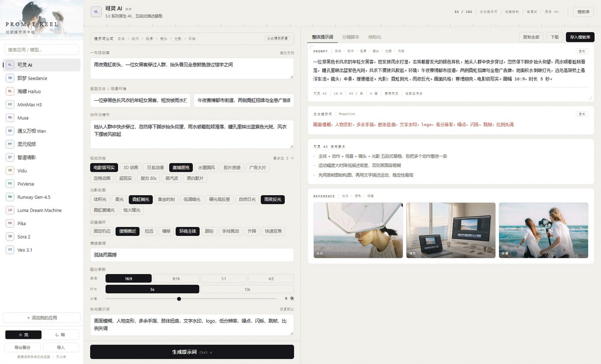
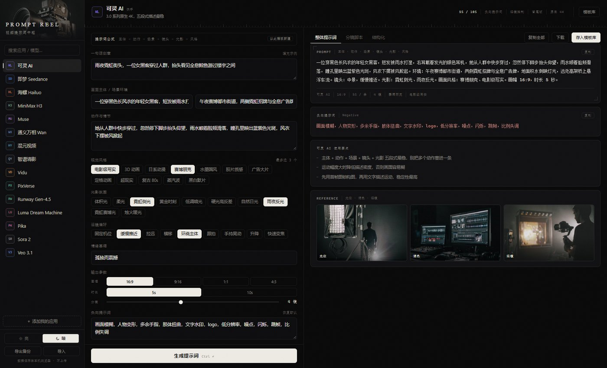

# PromptReel · 视频提示词中枢

同一个创意，按 **15 个视频模型的各自写法**重排一遍 —— 而不是一套模板填空。

支持：可灵 AI、即梦 Seedance、海螺 Hailuo、MiniMax H3、Muse、通义万相、混元视频、智谱清影、Vidu、PixVerse、Runway Gen-4.5、Luma、Pika、Sora 2、Veo 3.1。

`MIT License` · `零依赖` · `双击即用`

## 简介 · Introduction

**中文**

PromptReel 是一个视频提示词中枢，解决跨平台反复查找、改写模板的问题。同一个创意，可灵要写成五段式，海螺要先给 `[Push in]` 括号运镜，MiniMax H3 要拆成 `[Shot N]` 加音景与配乐，Sora 则要转成英文并声明音频。PromptReel 把这些差异沉淀成 15 套模板：填一次创意、主体、动作与场景，就能得到按所选平台结构重排的整体提示词，以及景别递进、运镜不重复的分镜脚本。除网页外还提供命令行与 MCP 服务，并支持自定义模板。

**English**

PromptReel is a prompt hub for AI video generation. Creators lose hours rewriting the same idea for every platform: Kling expects a five-part structure, Hailuo wants a bracketed camera command up front, MiniMax H3 splits shots into `[Shot N]` blocks with a separate soundscape and score, and Sora needs English with audio declared explicitly. PromptReel distils those differences into 15 independent templates. Describe your idea, subject, action and scene once, and it re-assembles them into a ready-to-paste prompt for the platform you picked — plus a shot-by-shot storyboard with progressive framing and non-repeating camera moves, each shot usable on its own. Beyond the web app it ships as a CLI and a zero-dependency MCP server, so it plugs into your own pipeline or AI assistant. You can also add your own platform templates to capture internal models and team conventions.



<details>
<summary>暗色主题</summary>



</details>

## 为什么不是"模板填空"

同一句话在可灵是五段式、在海螺要先给 `[Push in]` 括号运镜、在 H3 要拆成 `[Shot N]` + 音景 + 配乐、在 Sora 要写成英文并显式声明 `Audio:`。所以每个平台是一套**独立的结构 + 能力位**，而不是往同一个模板里塞词。

| 平台 | 语言 | 结构特点 |
|---|---|---|
| 可灵 AI | 中 | 主体→动作→场景→镜头→光影→风格 五段式，负向词独立 |
| 即梦 Seedance | 中 | `【画面主体】【动作】【镜头语言】` 标签换行 |
| 海螺 Hailuo | 中 | 运镜用 `[Push in]` 括号指令写在句首 |
| MiniMax H3 | 英 | `[Shot N]` 分镜 + `overall_soundscape` + `non_diegetic_music` |
| Muse | 中 | 主题/主体/动作/氛围/镜头/情绪 分行，情绪优先 |
| 通义万相 | 中 | 自然语句 + 句尾画质词 |
| 混元视频 | 中 | 强调物理真实、无变形 |
| 智谱清影 | 中 | 四段式 + 独立音效句 |
| Vidu | 中 | 简洁镜头语言，保角色一致性 |
| PixVerse | 中 | 特效模板向，动作写"发生那一刻" |
| Runway Gen-4.5 | 英 | 自然语言 + 35mm / lens 术语 |
| Luma | 英 | 短句 + smooth motion |
| Pika | 英 | 破折号分隔画面与风格 |
| Sora 2 | 英 | 写起点与终点，显式 `Audio:` |
| Veo 3.1 | 英 | 音效写具体拟音，台词加引号 |

## 四种用法

| 形态 | 入口 | 适合 |
|---|---|---|
| 网页应用 | 双击 `index.html` | 人用：点平台、填创意、复制提示词 |
| 命令行 | `node shared/cli.mjs` | 批量、脚本化、接进自己的工作流 |
| MCP 服务 | `node mcp/server.mjs` | 让 Claude / Cursor / WorkBuddy 直接调用 |
| Skill | `skill/SKILL.md` | 给 agent 的方法论 + CLI 用法 |

### 网页应用

无需服务器、无需构建，双击 `index.html` 就能用。

- 左侧平台列表切换，顶栏显示该平台的能力标签（负向词 / 括号运镜 / 音频 / 时长档位）
- 填创意 → 生成 **整体提示词** / **分镜脚本** / **结构化 JSON**
- 分镜自动配景别递进（远景→特写）与不重复的运镜序列
- 负向词、音效、配乐按平台能力自动显隐
- 「以此模板新建」把内置平台克隆成自己的版本再改
- 左下角切换**亮 / 暗**两套主题（默认跟随系统）：暗色是片场与剪辑台，亮色是海边外拍
- 数据存浏览器 localStorage，可导出 / 导入 JSON 备份

### 命令行

```bash
node shared/cli.mjs --list

node shared/cli.mjs -p kling \
  -b "雨夜霓虹街头，女黑客抬头看见全息鲸鱼" \
  --subject "穿黑风衣的年轻女黑客" \
  --action "穿过人群,停下抬头,雨水滑落" \
  --scene "午夜赛博都市街道，霓虹招牌，积水倒影" \
  --style "赛博朋克,电影级写实" --light "霓虹侧光,雨夜反光" \
  --camera "缓慢推近" --ratio 16:9 -d 5 -n 4 --format md

# 同一创意，全平台各出一版
node shared/cli.mjs -p all -b "手冲咖啡慢镜头，水汽升腾" --format json
```

`--action` 里用逗号分隔动作节点，会自动拆成多个分镜。

### MCP

```bash
node mcp/server.mjs     # stdio，由客户端拉起
```

工具：`list_platforms` / `generate_prompt` / `generate_all` / `get_platform_template` / `list_lexicon`。

各客户端配置见 [mcp/README.md](mcp/README.md)。

### Skill

`skill/SKILL.md` 是给 agent 的完整方法论（选平台、写主体、拆分镜、交付时说明平台约束），配套 `references/` 里有变量表和自动生成的平台模板参考。

### DeepSeek Harness (DSH)

DSH 插件（`promptreel-dsh 0.1.0`，已实测 DSH 0.2.1-rc.2）：注册 `promptreel` Skill 与 5 个原生工具（`promptreel_list_platforms` / `generate_prompt` / `generate_all` / `get_platform_template` / `list_lexicon`），与 CLI、MCP 共用 `shared/engine.mjs`，不另起 MCP 服务、不联网。安装与说明见 [docs/dsh.md](docs/dsh.md)：

```bash
dsh plugin --profile web add github:Thanksgiver233/PromptReel
```

标签：`dsh-plugin`（`package.json` keywords 与仓库 GitHub topic，便于 DSH 插件索引发现）。

### WorkBuddy / CodeBuddy 手动安装

WorkBuddy 暂无公开的 Skill / MCP 上架入口，先用手动安装：

```bash
git clone https://github.com/Thanksgiver233/PromptReel.git
cp -r PromptReel/skill ~/.codebuddy/skills/promptreel
# 或 WorkBuddy 路径：
cp -r PromptReel/skill ~/.workbuddy-ai/skills/promptreel
```

MCP 配置见 [mcp/README.md](mcp/README.md) 的 WorkBuddy 一节（写进 `~/.workbuddy-ai/mcp.json`）。

## 架构

```
src/                      ← 唯一数据源，只改这里
  theme.css               样式（含亮暗双主题）
  lexicon.js              风格 / 光影 / 运镜词库
  platforms.js            15 个平台的模板与能力位
        │
        │  node scripts/build.mjs
        ▼
index.html               单文件网页应用（可直接打开）
shared/platforms.json    ├→ CLI / MCP 读取的数据
shared/lexicon.json      │
shared/engine.mjs        └→ 组装引擎（CLI 与 MCP 共用）
shared/cli.mjs              命令行入口
mcp/server.mjs              MCP 服务（零依赖）
skill/                      Skill 定义与参考文档
```

网页版的组装逻辑在 `index.html` 里，CLI/MCP 的在 `shared/engine.mjs`。两份逻辑由 `scripts/parity.mjs` 强制对齐——它用无头浏览器跑一遍网页版，再和 CLI 版逐字段比对，不一致就报错。

## 开发

```bash
node scripts/build.mjs         # 注入 src → index.html，导出 shared/*.json
node scripts/gen-reference.mjs # 重新生成 skill/references/platforms.md
node scripts/parity.mjs        # 校验网页版与 CLI 版输出一致
```

改平台见 [CONTRIBUTING.md](CONTRIBUTING.md)。

图片素材处理（裁掉生成水印并压缩）需要 Pillow：

```bash
pip install pillow
python scripts/prepare-images.py
```

## 说明

平台能力与版本在持续变化，模板里的版本号是撰写时的参考，不是对官方规格的承诺。所有模板都可以在网页里克隆后自行修改。

## License

[MIT](LICENSE)
